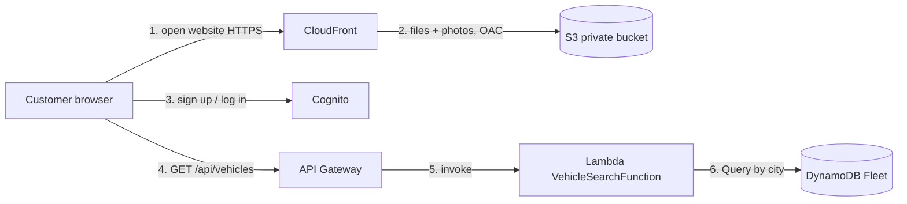

# Capston Rent – Serverless Car Rental on AWS

Capstone project · AWS Cloud Engineer training (neuefische) · Ahmad Navid Tahir

Capston Rent is a car rental website. A customer chooses a city and rental dates and sees every car with photo, description and total price. Customers can sign up and log in. The whole backend is **serverless on AWS**: nothing runs, and almost nothing costs money, while nobody uses it.

**Live:** https://d2g6kxklp5d5h.cloudfront.net


## Features

- Search by city (Hamburg, Berlin, Munich), pick-up date, return date and optional car type
- Results with photo, description, seats, transmission, fuel, price per day and **total price**, cheapest first
- Clear error messages for invalid input
- **Sign up, log in and log out** with Amazon Cognito (email confirmation)
- Website over **HTTPS** through CloudFront, private S3 bucket
- Works on desktop and mobile

## How it works



1. The customer opens the website over HTTPS. CloudFront delivers it from a **private S3 bucket** (Origin Access Control).
2. The customer can sign up and log in with **Cognito**.
3. The customer searches. The website sends the search to **API Gateway**.
4. API Gateway starts the **Lambda** function.
5. Lambda checks the input, gets the cars for that city from **DynamoDB** and calculates the total price.
6. The website shows the cars; the photos load from S3 through CloudFront.

More detail: [docs/01-architecture.md](docs/01-architecture.md)

## AWS services

| Service | Role | Why |
|---|---|---|
| Amazon S3 | Website files and car photos | Cheap, durable, no server |
| CloudFront | HTTPS front door, cache | Secure, fast, keeps the bucket private |
| Amazon Cognito | Sign-up, login, logout | No own password storage, email verification |
| API Gateway (HTTP API) | Public search API | Pay per request, CORS |
| AWS Lambda | Search and price logic | Runs only on request |
| Amazon DynamoDB | Car data (Fleet table) | Serverless, fast Query by city |
| IAM, CloudWatch | Permissions and logs | Least privilege, debugging |

## Repository structure

```
capstone-car-rental/
├── frontend/          Website (uploaded to S3)
│   ├── index.html
│   ├── style.css
│   ├── app.js         Search
│   ├── auth.js        Login with Cognito
│   └── images/        Car photos
├── backend/           Lambda code, sample data, load script
├── infrastructure/    Bucket policy, test event, list of AWS resources
├── terraform/         Website (S3 + CloudFront) as infrastructure as code
├── docs/              Documentation, screenshots, diagrams
└── local_server.py    Run the project on your PC
```

## Quick start (local)

```bash
python local_server.py
```

Open http://localhost:8000. Locally, the search reads `backend/cars.json`. (Login only works on the CloudFront URL.)

## Documentation

| Document | Content |
|---|---|
| [01 – Architecture](docs/01-architecture.md) | Components, flow, Lambda logic, data model |
| [02 – Local setup](docs/02-local-setup.md) | Run and test on your PC |
| [03 – AWS deployment](docs/03-aws-deployment.md) | Every step in the AWS Console, with screenshots |
| [04 – Testing](docs/04-testing.md) | Lambda, API, website and login tests |
| [05 – Troubleshooting](docs/05-troubleshooting.md) | Errors I hit and how I fixed them |
| [MVP (PDF)](docs/MVP.pdf) | Minimum Viable Product |

## Project status

| Done | Next |
|---|---|
| Website on S3 behind CloudFront (HTTPS) | Booking (only for logged-in customers) |
| DynamoDB Fleet table with 10 cars | Booking workflow with Step Functions |
| Lambda + API Gateway search | Email confirmations (EventBridge, SES) |
| Cognito sign-up, login, logout | Run the Terraform code |
| Private bucket, CORS only for the website | |

## Author

Ahmad Navid Tahir – AWS Cloud Engineer training, neuefische, 2026
