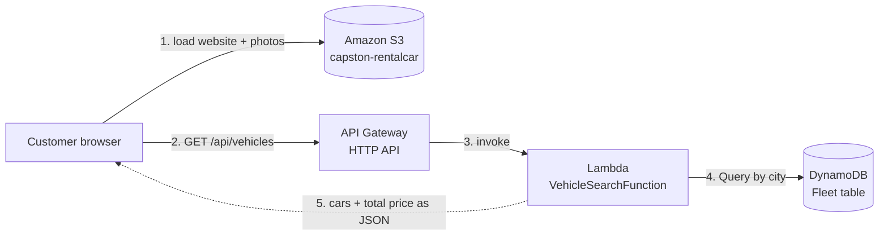

# Elbe Rent – Serverless Car Rental on AWS

Capstone project · AWS Cloud Engineer training (neuefische) · Ahmad Navid Tahir

Elbe Rent is a car rental website. A customer chooses a city and rental dates and sees every car with photo, description and total price. The whole backend is **serverless on AWS**: nothing runs, and almost nothing costs money, while nobody searches.


## Features (MVP)

- Search by city (Hamburg, Berlin, Munich), pick-up date, return date and optional car type
- Results with photo, description, seats, transmission, fuel, price per day and **total price**
- Cheapest car first
- Clear error messages for invalid input (missing city, wrong dates, more than 30 days)
- Works on desktop and mobile

## How it works



1. The customer opens the website. The browser loads the page from **S3**.
2. The customer picks a city and dates and clicks **Search cars**. The website sends the search to **API Gateway**.
3. API Gateway starts the **Lambda** function.
4. Lambda checks the input, gets the cars for that city from **DynamoDB** and calculates the total price (price per day × days).
5. Lambda sends the cars back as JSON. The website shows them, and the photos load from the `images` folder in S3.

More detail: [docs/01-architecture.md](docs/01-architecture.md)

## AWS services

| Service | Role | Why |
|---|---|---|
| Amazon S3 | Website files and car photos | Cheap, durable, no server |
| API Gateway (HTTP API) | Public search API | Pay per request, CORS, throttling |
| AWS Lambda | Search and price logic | Runs only on request, no servers to manage |
| Amazon DynamoDB | Car data (Fleet table) | Serverless, fast Query by city |
| IAM | Permissions | Lambda may only read the database and write logs |
| CloudWatch | Logs | Debugging and monitoring |

## Repository structure

```
capstone-car-rental/
├── frontend/                 Website (uploaded to S3)
│   ├── index.html
│   ├── style.css
│   ├── app.js
│   └── images/               Car photos (HH-001.jpg …)
├── backend/
│   ├── lambda_function.py    Lambda VehicleSearchFunction
│   ├── cars.json             10 sample cars
│   └── load_cars.py          Loads cars.json into DynamoDB
├── infrastructure/           Bucket policy, test event, list of AWS resources
├── docs/                     Step-by-step documentation, screenshots, diagrams
└── local_server.py           Runs the whole project on your PC
```

## Quick start (local)

Requirement: Python 3.10 or newer, no extra packages.

```bash
python local_server.py
```

Open http://localhost:8000. Locally, the Lambda code reads `backend/cars.json` instead of DynamoDB.

Full guide: [docs/02-local-setup.md](docs/02-local-setup.md)

## Documentation

| Document | Content |
|---|---|
| [01 – Architecture](docs/01-architecture.md) | Components, flow, Lambda logic, data model |
| [02 – Local setup](docs/02-local-setup.md) | Run and test the project on your PC |
| [03 – AWS deployment](docs/03-aws-deployment.md) | Every step in the AWS Console, with screenshots |
| [04 – Testing](docs/04-testing.md) | Lambda test, API test, browser test |
| [05 – Troubleshooting](docs/05-troubleshooting.md) | Errors I hit and how I fixed them |
| [MVP (PDF)](docs/MVP.pdf) | Minimum Viable Product |

## Project status

| Done | Next |
|---|---|
| Website built and tested locally | CloudFront with HTTPS in front of S3 and the API |
| Website hosted on S3 | Login with Cognito |
| DynamoDB Fleet table with 10 cars | Booking with Step Functions |
| Lambda + API Gateway connected to the website | Notifications (EventBridge, SES, SNS) |

Target architecture for the next phases: [docs/images/architecture-target.png](docs/images/architecture-target.png)

## Author

Ahmad Navid Tahir – AWS Cloud Engineer training, neuefische, 2026
