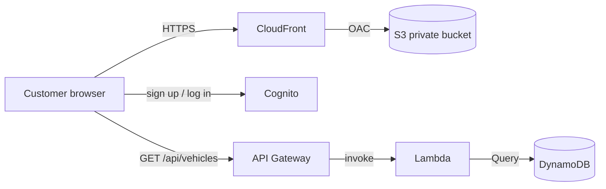
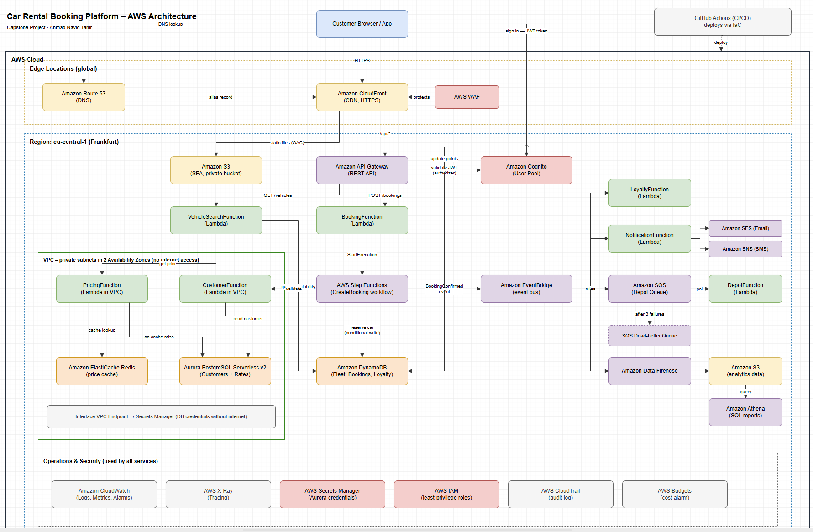

# 01 – Architecture

## Current architecture



- **CloudFront** delivers the website over HTTPS. The S3 bucket is private; only CloudFront can read it through **Origin Access Control (OAC)**.
- **Cognito** handles sign-up (with email code), login and logout.
- The browser calls **API Gateway** directly. CORS allows only the CloudFront URL.

Diagram file: [diagrams/capston-rent-built-so-far.drawio](diagrams/capston-rent-built-so-far.drawio)

Target architecture for later phases: 

## Step-by-step flow

1. The customer opens the website. CloudFront delivers `index.html`, `style.css`, `app.js` and `auth.js` from the private S3 bucket.
2. The customer picks a city and dates and clicks **Search cars**.
3. `app.js` sends `GET /api/vehicles?location=Hamburg&from=2026-11-01&to=2026-11-05` to API Gateway.
4. API Gateway starts the Lambda function `VehicleSearchFunction`.
5. Lambda gets the cars for that city from the DynamoDB table `Fleet`.
6. Lambda calculates the total price for each car.
7. Lambda sends the cars and prices back through API Gateway.
8. The website shows the cars; the photos load from `images/` in S3.

## The Lambda function

File: [`backend/lambda_function.py`](../backend/lambda_function.py)

| Step | What it does |
|---|---|
| 1. Read the search | Takes `location`, `from`, `to` and `category` from the request |
| 2. Check the input | Returns HTTP 400 if the city is missing, a date is invalid or in the past, the return date is before the pick-up date, or the rental is longer than 30 days |
| 3. Count the days | 10 Oct to 14 Oct = 4 days |
| 4. Get the cars | `Query` on the Fleet table with `location` as key (fast, reads only that city) |
| 5. Calculate and answer | `totalPrice = pricePerDay × days`, sort cheapest first, return JSON (HTTP 200) |

The same code runs locally and on AWS: if the environment variable `TABLE_NAME` is set, it reads DynamoDB; otherwise it reads `cars.json`.

## Data model (DynamoDB table `Fleet`)

| Attribute | Type | Example |
|---|---|---|
| `location` (partition key) | String | `Hamburg` |
| `vehicleId` (sort key) | String | `HH-001` |
| `brand`, `model`, `category` | String | `Volkswagen`, `Golf`, `Compact` |
| `seats` | Number | `5` |
| `transmission`, `fuel` | String | `Manual`, `Petrol` |
| `pricePerDay` | Number | `45` |
| `description` | String | `The all-rounder for city and motorway…` |
| `image` | String | `images/HH-001.jpg` |

**Why `location` is the partition key:** every search filters by city, so Lambda can use a fast `Query` instead of a slow `Scan` over the whole table.

**Where things are stored:** car photos are files in S3 (`images/`); all other car information is in DynamoDB. The `image` field links the two.

## API

`GET /api/vehicles`

| Parameter | Required | Example |
|---|---|---|
| `location` | yes | `Hamburg` |
| `from` | yes | `2026-11-01` |
| `to` | yes | `2026-11-05` |
| `category` | no | `SUV` |

Example response (shortened):

```json
{
  "location": "Hamburg",
  "days": 4,
  "count": 4,
  "vehicles": [
    { "vehicleId": "HH-001", "brand": "Volkswagen", "model": "Golf",
      "pricePerDay": 45, "totalPrice": 180, "image": "images/HH-001.jpg" }
  ]
}
```
