# 03 – AWS deployment

Everything was created in the **AWS Management Console**, region **us-east-1 (N. Virginia)**.

Overview of all resources: [infrastructure/aws-resources.md](../infrastructure/aws-resources.md)

## Step 1 – S3: host the website

1. **S3 → Create bucket**, name `capston-rentalcar`, region us-east-1.
2. Upload `index.html`, `style.css` and `app.js` to the top level of the bucket.
3. Create a folder `images` and upload the car photos, named after the vehicle ID (`HH-001.jpg`, `HH-002.jpg` …).
4. **Properties → Static website hosting → Enable**, index document `index.html`.
5. **Permissions → Bucket policy**: for the first tests, allow read access only from my own IP address. (Replaced by CloudFront in Step 7.)

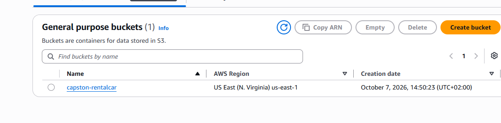

Bucket structure:

```
capston-rentalcar/
├── index.html
├── style.css
├── app.js
└── images/
    ├── HH-001.jpg
    └── …
```

## Step 2 – DynamoDB: store the car data

1. **DynamoDB → Create table**, name `Fleet`, partition key `location` (String), sort key `vehicleId` (String).
2. Open **CloudShell**, upload `backend/cars.json` and `backend/load_cars.py`.
3. Run:
   ```bash
   python3 load_cars.py
   ```
   Output: `10 cars loaded into Fleet`
4. Check under **Explore table items** that all 10 cars are there.

> 📸 Add screenshot: `images/02-dynamodb-items.png`

## Step 3 – Lambda: the search function

1. **Lambda → Create function → Author from scratch**, name `VehicleSearchFunction`, runtime **Python 3.12**.
2. Paste the code from [`backend/lambda_function.py`](../backend/lambda_function.py) and click **Deploy**.
3. **Configuration → Environment variables**: `TABLE_NAME` = `Fleet`.
4. **Configuration → General configuration**: timeout **10 seconds** (the default of 3 seconds was too short on the first run).
5. **Configuration → Permissions** → click the role name → **Add permissions → Attach policies** → `AmazonDynamoDBReadOnlyAccess`.

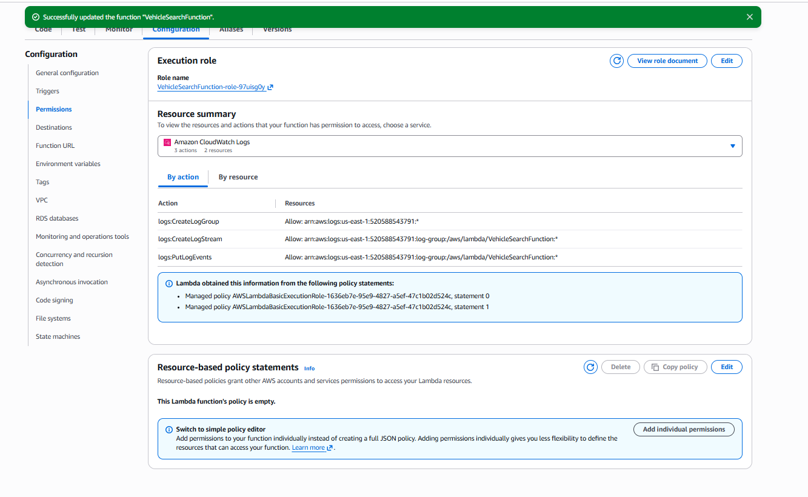

6. **Test** tab with the event from [infrastructure/lambda-test-event.json](../infrastructure/lambda-test-event.json). Result: `statusCode 200` with 4 Hamburg cars.

> 📸 Add screenshot: `images/03-lambda-test.png`

## Step 4 – API Gateway: the public API

1. **API Gateway → Create API → HTTP API → Build**.
2. Integration: **Lambda** → `VehicleSearchFunction`, API name `car-rental-api`.

   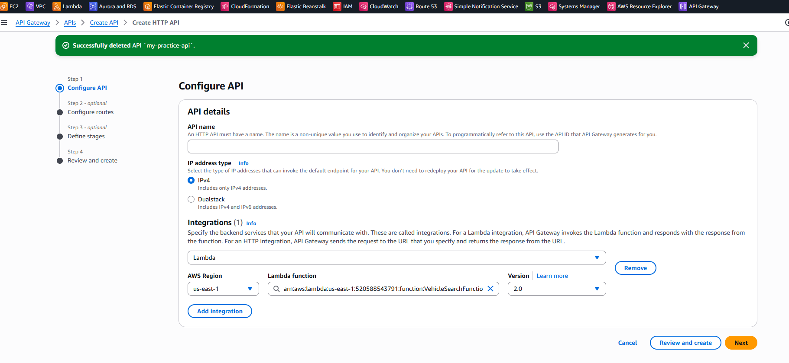

3. Route: **GET** `/api/vehicles` → `VehicleSearchFunction`.

   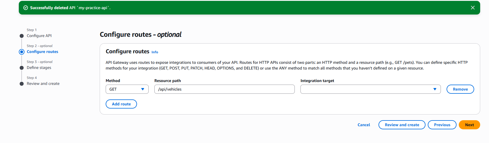

4. Stage `$default` with auto-deploy, then **Create**.

   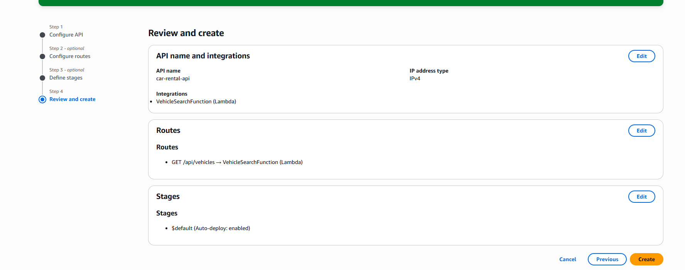

5. **CORS → Configure**: Allow-Origin `*`, Allow-Methods `GET`, Allow-Headers `*`.

   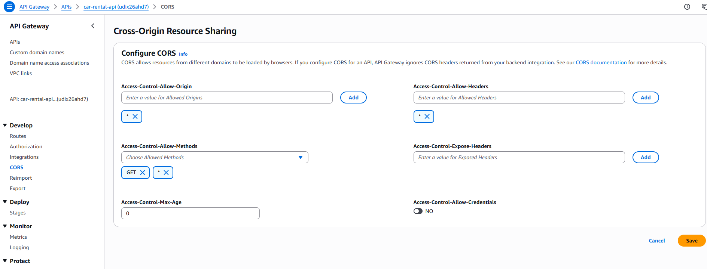

6. Test in the browser:
   ```
   https://<api-id>.execute-api.us-east-1.amazonaws.com/api/vehicles?location=Hamburg&from=2026-11-01&to=2026-11-05
   ```

   

## Step 5 – Connect the website to the API

In `frontend/app.js`, set the Invoke URL of the API:

```js
const API_URL = ["localhost", "127.0.0.1"].includes(location.hostname)
  ? "/api/vehicles"
  : "https://<api-id>.execute-api.us-east-1.amazonaws.com/api/vehicles";
```

Upload `app.js` to the bucket again.

## Step 6 – Test the whole flow

Open the S3 website URL, press **Ctrl+F5**, search for Hamburg.

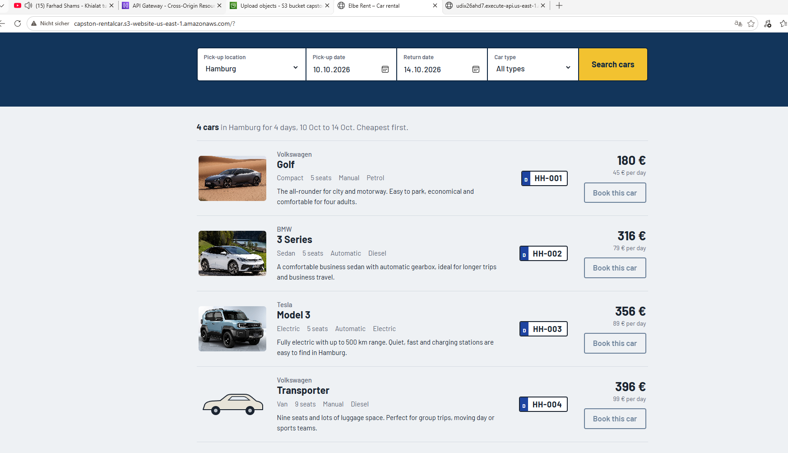

## Step 7 – CloudFront: HTTPS and a private bucket

1. **CloudFront → Create distribution**, name `capston-rentalcar-website`, single website.
2. Origin: **Amazon S3** → the bucket endpoint `capston-rentalcar.s3.us-east-1.amazonaws.com` (not the website endpoint). Keep **Allow private S3 bucket access to CloudFront** ticked (OAC).

   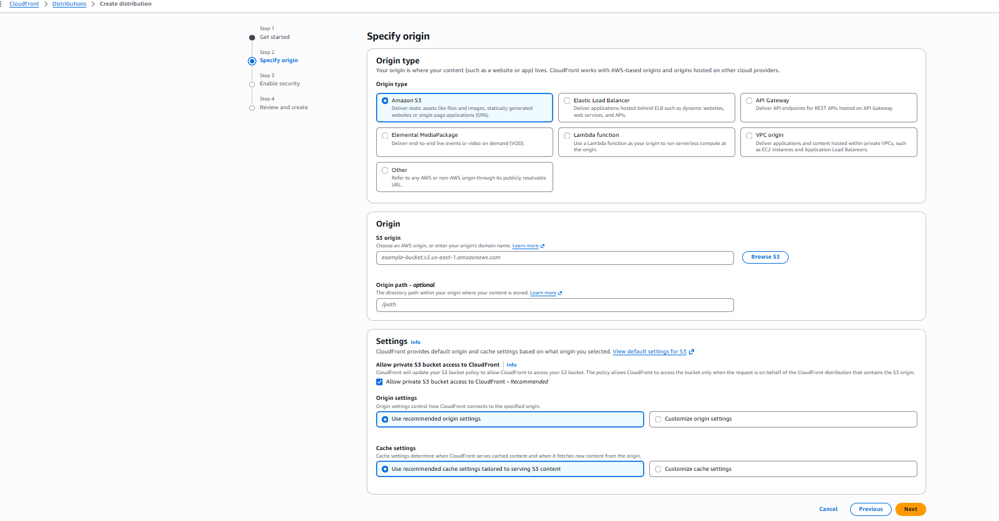

3. Security: **Do not enable** WAF (cost; planned for later).
4. After creation: **General → Settings → Edit → Default root object** = `index.html`.
5. Open `https://<distribution>.cloudfront.net`.

   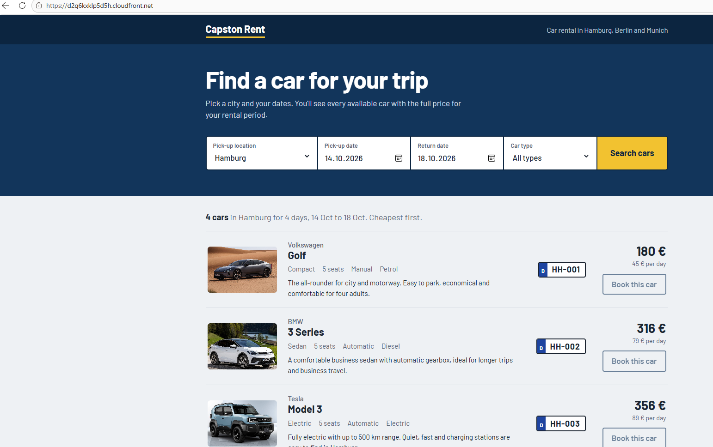

**Clean-up after CloudFront works**

- S3: switch off **Static website hosting**, remove the IP statement from the bucket policy (keep only the CloudFront statement: [bucket-policy.json](../infrastructure/bucket-policy.json)), switch **Block all public access** back on.
- API Gateway → **CORS**: Allow-Origin = `https://<distribution>.cloudfront.net` only, Allow-Methods `GET`.

> After uploading changed website files, create a CloudFront **invalidation** with `/*`, otherwise the old cached files are shown.

## Step 8 – Cognito: sign-up and login

1. **Cognito → Create user pool**: application type **Single-page application (SPA)**, sign-in with **Email**, self-registration **on**, required attribute `email`, return URL = CloudFront URL.
2. **App clients → (client) → Login pages → Edit**: callback URL and sign-out URL = CloudFront URL, grant type **Authorization code**, scopes **OpenID** and **Email**.

   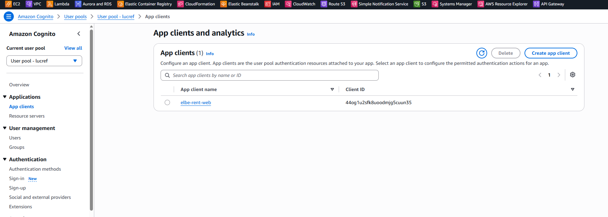

3. Put the Cognito domain and client ID into [`frontend/auth.js`](../frontend/auth.js), upload `auth.js` and `index.html` to S3, create an invalidation `/*`.
4. The website now shows **Log in** and **Sign up**:

   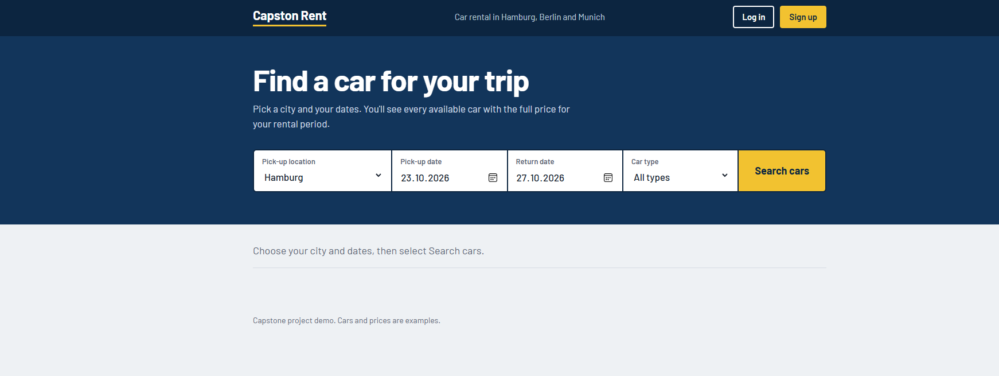

5. After sign-up (with email code) and login:

   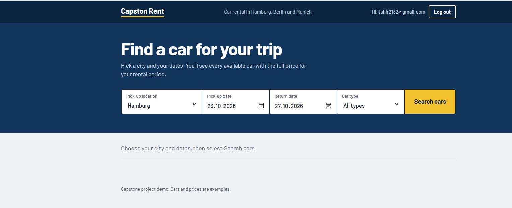

`auth.js` uses Cognito managed login with the **authorization code flow and PKCE**. The tokens stay in the browser session; the ID token will be sent to the booking API in the next phase.

## Next – Booking

Only logged-in customers can book. API Gateway will check the Cognito token (JWT authorizer) before the booking Lambda runs.
