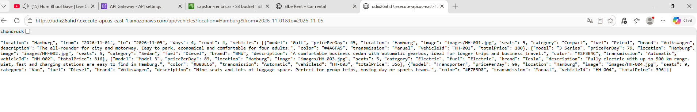

# 04 – Testing

## 1. Lambda test (AWS Console)

Event: [infrastructure/lambda-test-event.json](../infrastructure/lambda-test-event.json)

Expected: `statusCode: 200`, `count: 4`, the 4 Hamburg cars with `totalPrice`.

## 2. API test (browser)

```
https://<api-id>.execute-api.us-east-1.amazonaws.com/api/vehicles?location=Hamburg&from=2026-11-01&to=2026-11-05
```

Expected: the cars as JSON text.



## 3. Input validation

| Request | Expected |
|---|---|
| no `location` | 400 – "Choose a pick-up location." |
| `to` before `from` | 400 – "The return date must be after the pick-up date." |
| `from` in the past | 400 – "The pick-up date can't be in the past." |
| more than 30 days | 400 – "You can rent a car for up to 30 days." |
| `category=SUV` in Munich | 200 – only the 2 SUVs |

## 4. Website test

Open the website, search for each city, try a car type filter, and check on a phone.

## 5. See the API call

- **Browser:** press **F12 → Network**, click **Search cars**, open `vehicles?…` → **Response**.
- **AWS:** **Lambda → Monitor → View CloudWatch logs** shows every search with time and duration.

> 📸 Add screenshots: `images/04-network-tab.png`, `images/04-cloudwatch-logs.png`
