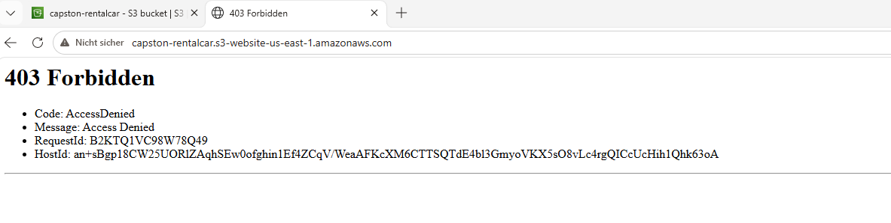
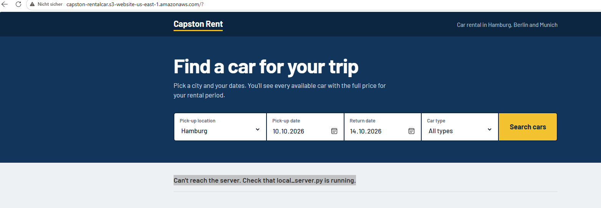
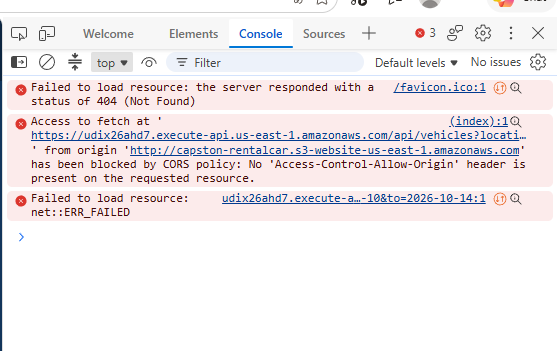

# 05 – Troubleshooting

Problems I hit while building the project, and how I fixed them.

## 403 Forbidden on the S3 website

**Causes:**
- Wrong bucket name in the bucket policy (bucket names can't contain spaces; mine is `capston-rentalcar`).
- My IP address had changed. Home connections get a new IP from time to time.

**Fix:** check the IP at https://checkip.amazonaws.com and update `aws:SourceIp` in the bucket policy.

## Lambda: "Task timed out after 3.00 seconds"

**Cause:** the default Lambda timeout is 3 seconds; the first run (cold start + DynamoDB connection) took longer.

**Fix:** **Configuration → General configuration → Timeout = 10 seconds**.

## Website: "Can't reach the server"

**Cause 1:** `app.js` still contained the placeholder URL `YOUR-API-ID`.
**Fix:** put the real Invoke URL into `app.js` and upload it again.

**Cause 2:** CORS. The browser console (F12) showed:

> blocked by CORS policy: No 'Access-Control-Allow-Origin' header

**Fix:** in API Gateway → **CORS**: Allow-Origin `*`, Allow-Methods `GET`, Allow-Headers `*`, then **Ctrl+F5**.

## Test URL "page not reachable"

**Cause:** the test address still contained the placeholder `your-invoke-url`.
**Fix:** use the real Invoke URL from the API's overview page.

## Website shows the old version after an upload

**Cause:** CloudFront caches the files.
**Fix:** CloudFront → **Invalidations → Create invalidation** with `/*`.

## Old S3 website address stops working

**Cause:** expected after the clean-up; static website hosting is off and the bucket is private.
**Fix:** always use the CloudFront URL.
